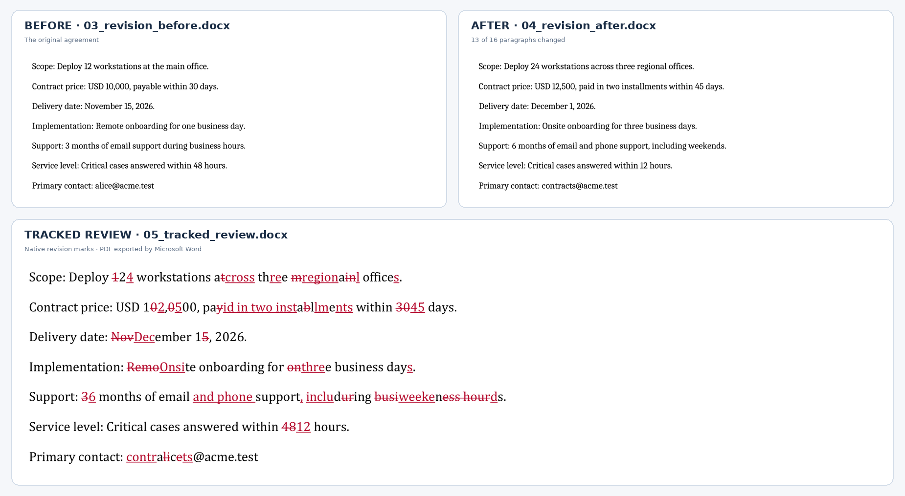
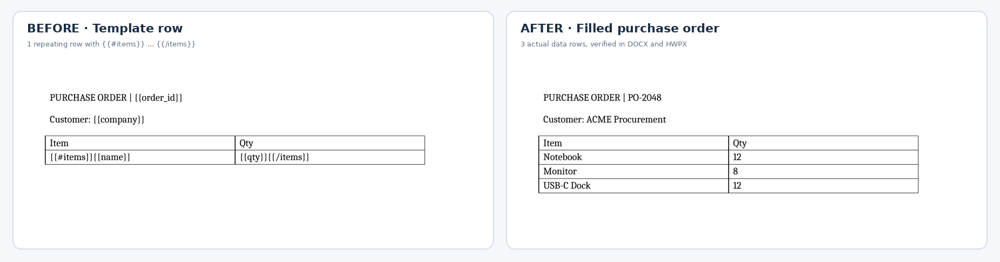
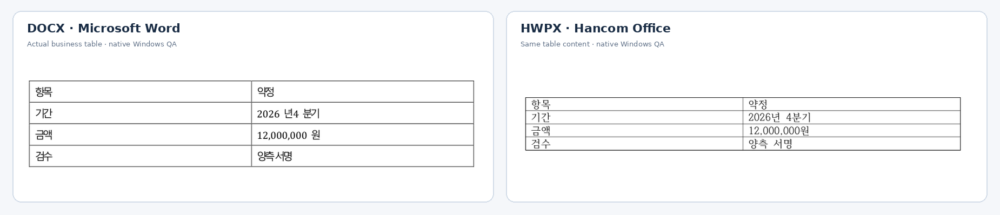

<div align="center">

# PyWPDoc

### Keep python-docx. Go beyond python-docx.

**Native Track Changes · Repeating Word tables · Safe template checks · DOCX + HWPX**

Built on **python-docx**, with advanced document workflows and a shared API for Hancom HWPX.

[**Track Changes**](#1-real-document-changes-not-just-a-diff-report) · [**Table templates**](#2-one-template-row-many-real-rows) · [**DOCX + HWPX**](#3-python-docx-underneath-two-formats-on-top) · [**API reference**](https://rydolabs.github.io/PyWPDoc/reference/document/) · [**한국어**](https://github.com/rydolabs/PyWPDoc/blob/main/README.ko.md)

</div>

## 1. Real document changes. Not just a diff report.

**BEFORE + AFTER → a third Word document with native tracked revisions.**



```python
from pywpdoc import Document

before = Document.open("examples/track_changes/03_revision_before.docx")
after  = Document.open("examples/track_changes/04_revision_after.docx")

before.compare(after, author="Reviewer").save("reviewed.docx")
```

**13 of 16 paragraphs changed.** The output contains supported native insertion/deletion revisions, not just red-colored text. Review the generated DOCX in Microsoft Word; neither original is overwritten.

**Open the actual files:** [Before `.docx`](examples/track_changes/03_revision_before.docx) · [After `.docx`](examples/track_changes/04_revision_after.docx) · [Tracked `.docx`](examples/track_changes/05_tracked_review.docx) · [Word-exported PDF](examples/track_changes/05_tracked_review_word_export.pdf)  
**HWPX sample:** [Before](examples/track_changes/03_revision_before.hwpx) · [After](examples/track_changes/04_revision_after.hwpx) · [Tracked](examples/track_changes/05_tracked_review.hwpx)

<sub>Image provenance: Before/After were rendered from the supplied DOCX files with LibreOffice for preview; the redline is cropped from the actual Microsoft Word PDF export. Word PDF inline revisions can overlap visually. See [image evidence](docs/assets/readme/PROVENANCE.md).</sub>

## What do you gain over python-docx?

| Capability | `python-docx` built-in | **PyWPDoc** |
|:---|:---|:---|
| Paragraphs, tables, runs and styles | **Yes** | **Yes — python-docx backend** |
| Access existing python-docx APIs | Native | **`doc.docx` / `doc.unwrap()`** |
| Compare files into *native* tracked revisions | Manual XML / external logic | **`before.compare(after)`** |
| Repeat actual template table rows | Manual / another package | **`render_template(..., table_rows=True)`** |
| Check missing template data *before* mutation | Manual | **`check_template()`** |
| Preview and safely replace text across runs | Custom code | **`preview_replace()` + `replace_text()`** |
| Edit Hancom HWPX documents | No | **Common `Document` API** |

*Compared with python-docx's built-in API, not the broader ecosystem. PyWPDoc deliberately uses python-docx as its DOCX backend; it is not a claim of drop-in API parity between DOCX and HWPX.*

## 2. Give it Python data. Get real repeating table rows.

**One template row + a Python list → a complete, editable purchase order — in DOCX and HWPX.**

**Word / Hangul template** — design the table once; mark a single row for repetition:

| Item | Qty |
|:---|---:|
| `{{#items}}{{name}}` | `{{qty}}{{/items}}` |

**Python — supply the values:**

```python
from pywpdoc import Document

data = {
    "order_id": "PO-2048",
    "company": "ACME Procurement",
    "items": [
        {"name": "Notebook", "qty": 12},
        {"name": "Monitor", "qty": 8},
        {"name": "USB-C Dock", "qty": 12},
    ],
}
```

**Validate, fill, and save both formats:**

```python
for fmt in ("docx", "hwpx"):
    doc = Document.open(f"examples/table_repeat/purchase-order-template.{fmt}")

    check = doc.check_template(data, sections=True, table_rows=True)
    if not check.ok:
        raise ValueError(check.to_dict())

    doc.render_template(data, sections=True, table_rows=True)
    doc.save(f"purchase-order-filled.{fmt}")
```

**Actual output — three editable table rows, not three lines inside one cell:**



**Run it:** [Complete Python script](examples/table_repeat/generate.py) · [DOCX template](examples/table_repeat/purchase-order-template.docx) / [filled document](examples/table_repeat/purchase-order-filled.docx) · [HWPX template](examples/table_repeat/purchase-order-template.hwpx) / [filled document](examples/table_repeat/purchase-order-filled.hwpx)

<sub>Actual PyWPDoc-generated DOCX files rendered with LibreOffice for the preview. The generated DOCX and HWPX files were saved and reopened to verify all three rows. This is not presented as a native Microsoft Word or Hancom screenshot. [Template guide →](https://rydolabs.github.io/PyWPDoc/guide/templates/)</sub>

## 3. python-docx underneath. Two formats on top.

**Keep the python-docx APIs you already use. Add portable workflows when you need them.**

```python
from pywpdoc import Document

doc = Document.open("existing.docx")
doc.docx.add_heading("Appendix", level=1)  # Real python-docx Document
doc.save("updated.docx")

for fmt in ("docx", "hwpx"):
    report = Document.new(fmt)
    report.add_paragraph("Quarterly report / 분기 보고서")
    report.save(f"quarterly.{fmt}")
```

**Actual native-app QA: the same business table in Microsoft Word and Hancom Office.** Cropped to the content instead of comparing page margins.



<sub>Source: previous Windows-native QA, 2026-10-18. These are genuine PDF-page excerpts, **not** proof of pixel-identical layout or document-format conversion. [Original full comparison](docs/assets/readme/docx-hwpx-original-qa.png) · [Image provenance](docs/assets/readme/PROVENANCE.md).</sub>

## 4. Preview before changing files.

```python
doc = Document.open("draft.docx")
preview = doc.preview_replace("Draft", "Approved")  # Read-only
if preview.has_matches:
    doc.replace_text("Draft", "Approved")
    doc.save("approved.docx")
```

Template validation and replacement previews inspect changes **before** you mutate the document. [Search & replace →](https://rydolabs.github.io/PyWPDoc/guide/search-replace/)

---

```bash
pip install pywpdoc
```

[**API reference**](https://rydolabs.github.io/PyWPDoc/reference/document/) · [Quickstart](https://rydolabs.github.io/PyWPDoc/getting-started/quickstart/) · [Templates](https://rydolabs.github.io/PyWPDoc/guide/templates/) · [Tracked Changes](https://rydolabs.github.io/PyWPDoc/guide/compare/) · [Compatibility](https://rydolabs.github.io/PyWPDoc/compatibility/) · [Limitations](https://rydolabs.github.io/PyWPDoc/limitations/)

<sub>**Scope:** `.docx` and `.hwpx` are separate editable formats. PyWPDoc does not convert between them or handle legacy binary `.hwp`. Native tracked comparison supports documented text/structure/format cases; unsupported changes (including HWPX table-row insertion/deletion tracking) are rejected rather than silently discarded. Actual layout depends on the native editor.</sub>

[GitHub](https://github.com/rydolabs/PyWPDoc) · [PyPI](https://pypi.org/project/pywpdoc/) · [MIT License](https://github.com/rydolabs/PyWPDoc/blob/main/LICENSE)