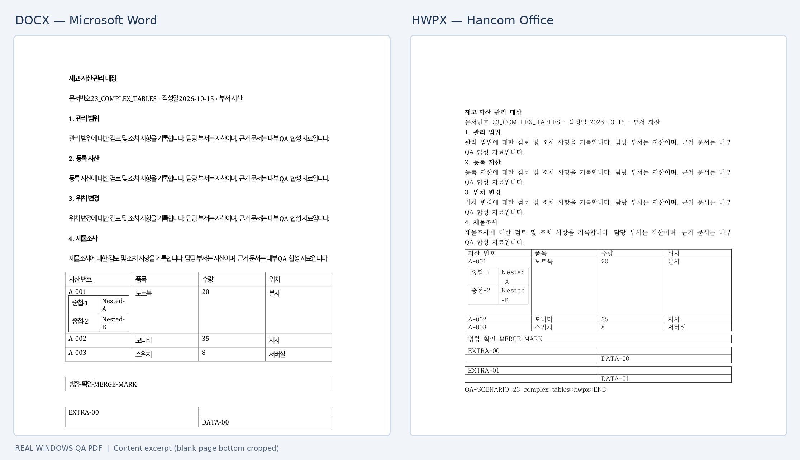

# Tables

```python
from pywpdoc import Document

doc = Document.new("hwpx")  # or "docx"
t = doc.add_table(2, 2)
t.cell(0, 0).text = "Item"
t.cell(0, 1).text = "Count"
t.cell(1, 0).text = "Notebook"
t.cell(1, 1).text = "12"
doc.save("purchase.hwpx")
```

Common APIs: `add_table(rows, cols, style=None)`, `doc.tables`, `table.cell(row, col)`, `table.rows`, `cell.text`. The resulting wrapper type is **backend-owned**. Style identifiers, merge geometry, nested tables and revision behavior may vary; see [format-specific reference](../reference/formats.md). Complex merged tables require dedicated visual QA rather than assuming identical editor layout.



*Native QA illustration, not a promise of pixel-equal output.*
