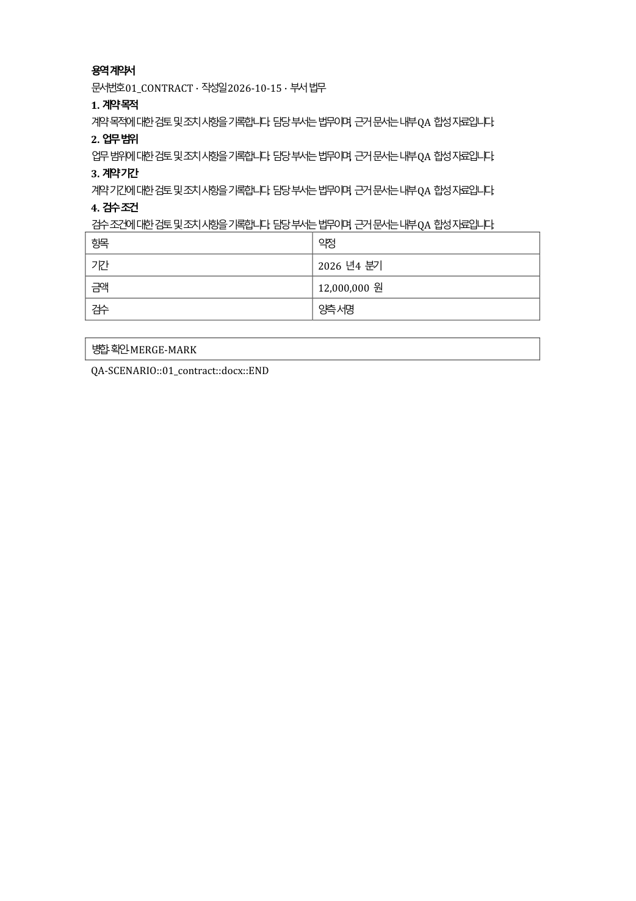
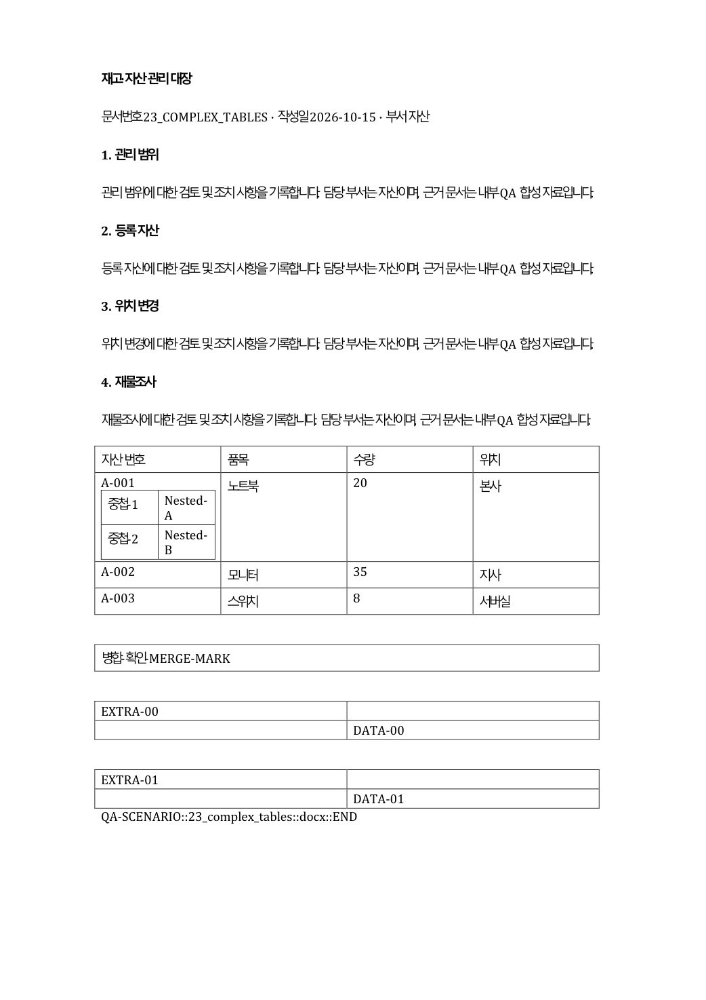
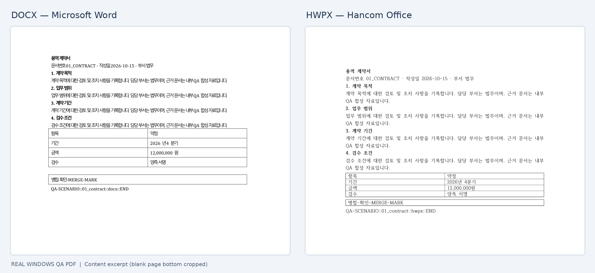

# PyWPDoc — document automation and review

**Validate templates, preview text edits and create tracked revisions for Word DOCX in Python.** Hancom Hangul HWPX also supports the documented shared workflows.

**Install with one command (from 0.44.0):**

```bash
pip install pywpdoc
```

The previously published `0.44.0rc1` prerelease still needs `pip install "pywpdoc[unified]==0.44.0rc1"` for DOCX. New `0.44.0` publication is a separate release step.

## Quick examples

**Template preflight and filling**

```python
from pywpdoc import Document

doc = Document.new("docx")
doc.add_paragraph("Customer: {{customer.name}}")
values = {"customer": {"name": "Acme Corp"}}

check = doc.check_template(values)
if not check.ok:
    raise ValueError(check.missing_keys)
doc.render_template(values)
doc.save("contract.docx")
```

**Tracked revisions**

```python
before = Document.new("docx")
before.add_paragraph("Amount: 100")
after = Document.new("docx")
after.add_paragraph("Amount: 200")
review = before.compare(after)
review.save("changes.docx")
```

**Read-only replacement preview**: `doc.preview_replace("Old", "New")` reports candidates without changing the document. Use `replace_text()` only after review.

## Verified native-document previews







*These images are from earlier Windows Word/Hancom QA, not freshly generated 0.44.0 visual-QA results or a tracked-revision screenshot. [Provenance](assets/readme/PROVENANCE.md) · [Prior RC native test scope](testing/native-qa-0440rc1-2026-10-18.md).*

## Jump straight to the right API

- [Document API signatures and portable contract](reference/document.md)
- [Template tags, preflight and rendering](guide/templates.md)
- [Tracked Changes and comparison](guide/compare.md)
- [Preview, find and replace](guide/search-replace.md)
- [Installation](getting-started/installation.md) · [Runnable examples](getting-started/quickstart.md)
- [Result types and exceptions](reference/results-errors.md)
- [Coding agent API selector](agent-guide.md) · [한국어 가이드](ko/index.md)

Some document structures and text boundaries are deliberately unsupported. `save()` does **not** convert formats, binary `.hwp` is unsupported, and layout equality is never guaranteed. [Compatibility](compatibility.md) · [Limitations](limitations.md).
